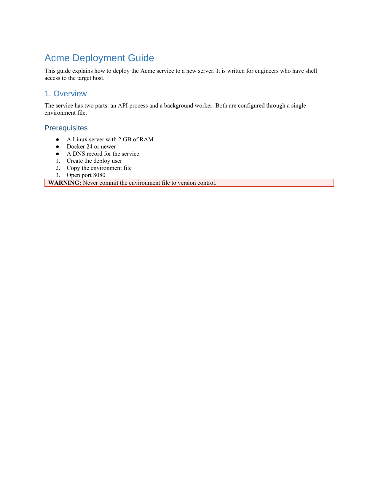
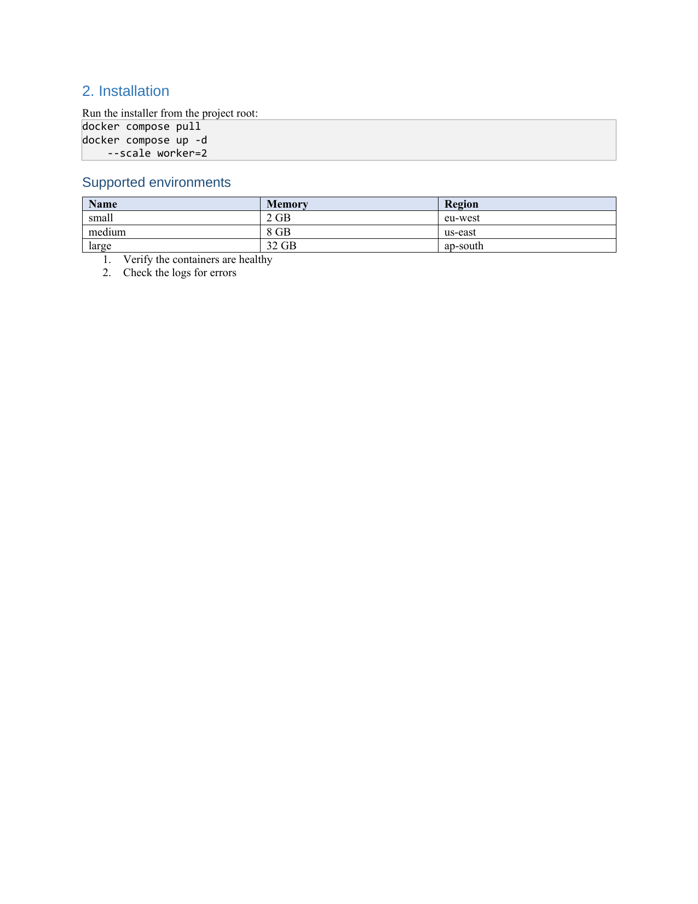
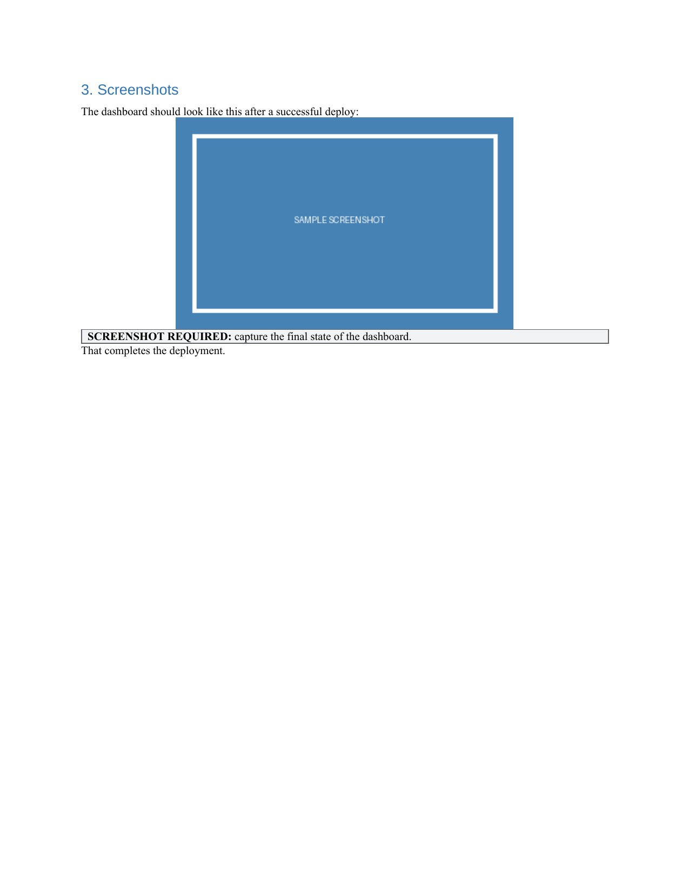

# Example conversion

A worked example of the PDF → DOCX rebuild. All three files were produced by:

```bash
node scripts/pdf-to-docx.js examples/sample.pdf examples/sample.docx
```

| File | What it is |
|---|---|
| `sample.pdf` | Input — a 3-page technical doc with headings, bullet and numbered lists, a table, a code block, callout boxes, a running header/footer, and an embedded screenshot. |
| `sample.docx` | Output — the rebuilt Word document (open it in Word or LibreOffice). |
| `preview-page1.png` … `preview-page3.png` | The output `.docx` rendered back to page images (the tool's own verification step). |

## What to look for in the output

- **Headings** (`Acme Deployment Guide`, `1. Overview`, `2. Installation`, …)
  are real Word headings detected from font size/weight — note `1. Overview`
  is correctly a heading, not mistaken for a numbered-list item.
- **Two separate numbered lists** each restart at 1 instead of running
  continuously (a Word numbering pitfall this tool handles explicitly).
- **The table** has a shaded header row and explicit column widths.
- **The code block** is monospace with background shading.
- **Callouts** (`WARNING:`, `SCREENSHOT REQUIRED:`) are bordered, colored boxes.
- **The screenshot** lands inline next to the paragraph it followed in the PDF.
- **The running header and `Page N of 3` footer are gone** — stripped as
  repeated page furniture.

### Rendered output

Page 1 | Page 2 | Page 3
---|---|---
 |  | 
